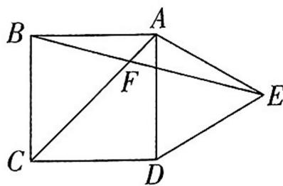
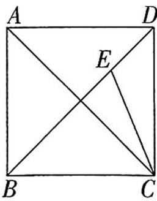

<!-- question-source:start -->
2[2024 江西南昌调研]如图,在正方形 ABCD 的外侧,作等边三角形 ADE,AC,BE 相交于点 F,则 $\angle BFC$ 的度数为 ( )
A. $45^{\circ}$ B. $55^{\circ}$ C. $60^{\circ}$ D. $75^{\circ}$

(第2题图)

(第3题图)
<!-- question-source:end -->

![[Q00107337A1]]
