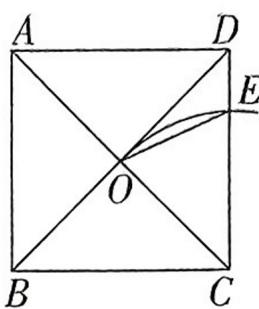
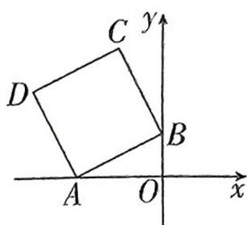

<!-- question-source:start -->
4[2025 福建泉州质检]如图,在正方形 ABCD 中,对角线 AC 与 BD 相交于点 O,以点 C 为圆心,CO 长为半径作弧,交 CD 于点 E,连接 OE,则 $\angle DOE=$ \_\_\_\_度.

建议用时 30 分钟 答案 D11

(第 4 题图)
(第5题图)
<!-- question-source:end -->

![[Q00107339A1]]
