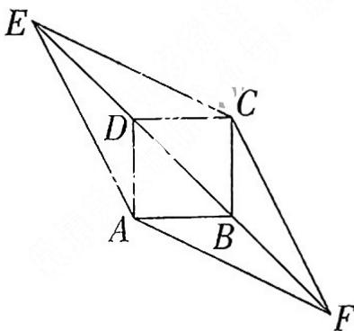

<!-- question-source:start -->
6[2025 山西晋中质检]如图, 四边形 ABCD 是边长为 1 的正方形, 分别延长 BD, DB 至点 E, F, 使 $BF = DE = \sqrt{2}$ , 连接 AE, AF, CE, CF.

(1) 求证: 四边形 AECF 是菱形;

(2)求四边形 AECF 的面积.

②刷易错 ▶资料更新，关注公众号★全科AA+ 易错点 默认三点共线致错
<!-- question-source:end -->

![[Q00107341A1]]
