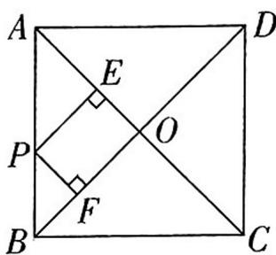
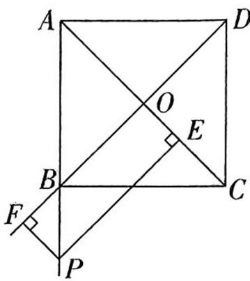

<!-- question-source:start -->
6 教材拓展,[2025 安徽宿州质检,中]已知正方形 $ABCD$ 的边长为 $a$ , 两条对角线 $AC,BD$ 相交于点 $O,P$ 是射线 $AB$ 上任意一点, 过 $P$ 点分别作直线 $AC,BD$ 的垂线 $PE,PF$ , 垂足分别为 $E,F$ . (1)如图(1), 当 $P$ 点在线段 $AB$ 上时, $PE+PF$ 的值是否为定值? 如果是, 请求出它的值; 如果不是, 请说明理由.

(2)如图(2), 当 $P$ 点在线段 $AB$ 的延长线上时, 求 $PE - PF$ 的值.

图(1)

图(2)
<!-- question-source:end -->

![[Q00107346A1]]
