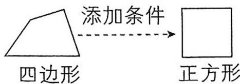

<!-- question-source:start -->
1 一个四边形顺次添加下列中的三个条件便得到正方形：
a. 两组对边分别相等
b. 一组对边平行且相等
c. 一组邻边相等
d. 一个角是直角

顺次添加的条件:① $a\rightarrow c\rightarrow d$ ,② $b\rightarrow d\rightarrow c$ ,③ $a\rightarrow$ $b \rightarrow c$ , 则正确的是 ( )

A. 仅①
B. 仅③
C. ①②
D. ②③
<!-- question-source:end -->

![[Q00107757A1]]
