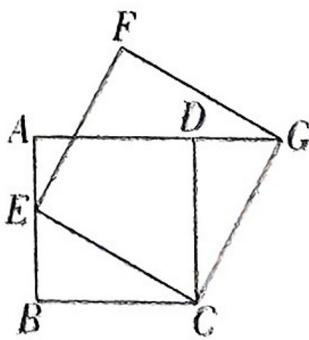

<!-- question-source:start -->
7 已知正方形 $ABCD$ , 点 $E$ 在边 $AB$ 上, 以 $CE$ 为边作正方形 $CEFG$ , 如图所示, 连接 $DG$ . 求证: $\triangle BCE \cong \triangle DCG$ . 王俊同学的证明过程如下, 他的证明过程正确吗? 若不正确, 请改正.

证明:∵ 四边形 ABCD 和四边形 CEFG 都是正方形,∴ CB = CD, CE = CG. ∵ ∠B = ∠CDG = 90°,∴ Rt△BCE≌Rt△DCG(HL).

<!-- question-source:end -->

![[Q00107758A1]]
