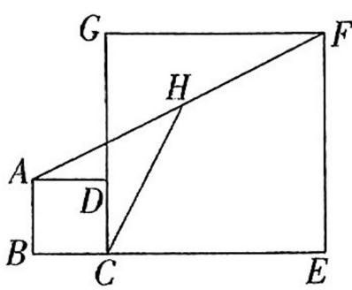
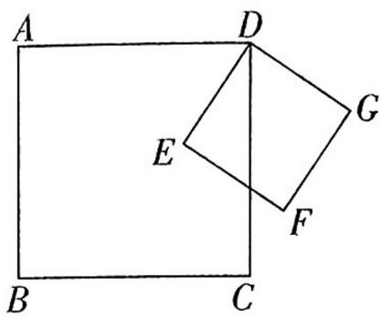

<!-- question-source:start -->
1 [中]如图,正方形ABCD和正方形CEFG中,点D在CG上,BC=1,CE=3,H是AF的中点,那么CH的长是()A. $\frac{5}{2}$ B. $\sqrt{5}$ C. $\frac{3\sqrt{2}}{2}$ D.2

(第1题图)

(第2题图)
<!-- question-source:end -->

![[Q00107759A1]]
