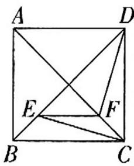
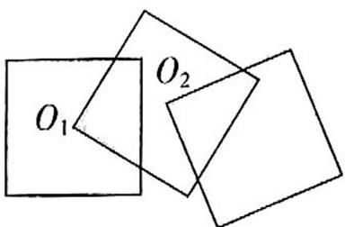

<!-- question-source:start -->
3 [2025 重庆沙坪坝区期末, 中] 如图, 在正方形 $ABCD$ 中, 点 $E$ , 点 $F$ 分别是对角线 $BD, AC$ 上的点, 连接 $CE, EF, DF$ , 若 $EF \parallel BC$ , 且 $\angle CEF = 15^{\circ}$ , 则 $\angle EDF$ 的度数为 \_\_\_\_.

(第3题图)

(第4题图)
<!-- question-source:end -->

![[Q00107761A1]]
