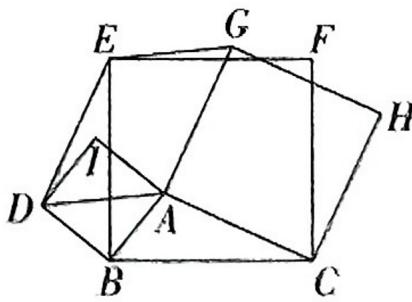

<!-- question-source:start -->
7 核心素养推理能力 [2024 山东烟台调研,较难] 如图,以 $\triangle ABC$ 的各边为边,在边 $BC$ 的同侧分别作正方形 $ABDI$ ,正方形 $BCFE$ ,正方形 $ACHG$ ,连接 $AD,DE,EG$ .

(1) 求证: $\triangle BDE \cong \triangle BAC$ .

(2) 求证: 四边形 $ADEG$ 是平行四边形.

(3) ① 当 $\triangle ABC$ 满足什么条件时,四边形 $ADEG$ 是矩形?

② 当 $\triangle ABC$ 满足什么条件时,四边形 $ADEG$ 是正方形?

<!-- question-source:end -->

![[Q00107762A1]]
