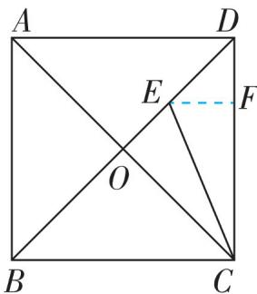

> [!success]- 必刷题
>
> > [!success] **【答案】** D
>
> > [!note]- **【解析】**
> > 如图, 过点 E 作设 AC 交 BD 于点 O. ∵ 四边形 ABCD 是正方形, ∴ AC ⊥ BD, ∠BDC = 45°. ∵ CE 平分 ∠ACD 交 BD 于点 E, ∴ ∠ECO = ∠ECF, EO = EF.
> >
> > 
> >
> > ∵ 正方形 ABCD 的边长为 2, ∴ AB = BC = 2,
> > ∴ 由勾股定理得 $AC = \sqrt{AB^{2} + BC^{2}} = \sqrt{2^{2} + 2^{2}} = 2\sqrt{2}$ , ∴ $CO = \frac{1}{2}AC = \sqrt{2}$ . 在 $\triangle EOC$ 和 $\triangle EFC$ 中， $\left\{\begin{aligned}\angle EOC&=\angle EFC,\\ \angle OCE&=\angle FCE,\\ EO=EF,\end{aligned}\right.$ (AAS), $\therefore CF=CO=\sqrt{2}.\because EF\perp DC,\angle BDC=45^{\circ},\therefore \triangle DEF$ 为等腰直角三角形, $\therefore EF=DF=DC-CF=2-\sqrt{2},\therefore DE=\sqrt{2}DF=2\sqrt{2}-2.$ 故选 D.
> >
> > 易错警示
> > 从已知条件不能确定 A, D, G 三点共线，即不能推出 $\angle GDC = 90^{\circ}$ .
