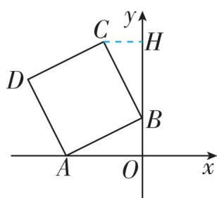

> [!success]- 必刷题
>
> > [!success] **【答案】** (-1,3)
>
> > [!note]- **【解析】**
> > 如图, 过 C 作 $CH \perp y$ 轴于 H. ∵ A 的坐标是 $(-2,0)$ , B 的坐标是 $(0,1)$ , ∴ OA = 2, OB = 1.
> > ∵ 四边形 ABCD 是正方形，
> >
> > 
> >
> > 思路分析
> > 由正方形的性质得到 $\angle OCD=$ $45^{\circ}$ , 由作图得到 $OC=CE$ , 从而得到 $\angle COE=$ $\angle CEO=\frac{1}{2} \times$
> >
> > (180°-∠OCD)，再根据角的和差即可求出∠DOE的度数.
> >
> > $\therefore AB = BC, \angle ABC = 90^{\circ}.\because \angle CBH + \angle ABO + \angle ABC = 180^{\circ}, \therefore \angle CBH + \angle ABO = 90^{\circ}.$ $\because \angle BAO + \angle ABO = 90^{\circ}, \therefore \angle CBH = \angle BAO.$ $\because \angle BHC = \angle AOB = 90^{\circ}, BC = AB, \therefore \triangle BCH \cong \triangle ABO(AAS), \therefore CH = OB = 1, BH = AO = 2,$ $\therefore OH = OB + BH = 3, \therefore C$ 的坐标是(-1,3). 故答案为(-1,3).
