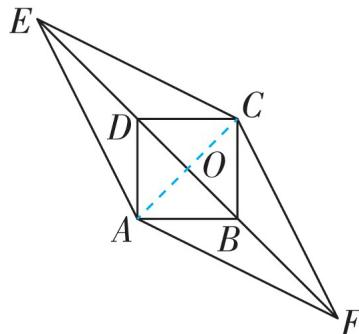

> [!success]- 必刷题
>
> > [!success] **【答案】** (1)
>
> > [!note]- **【解析】**
> > 【证明】如图, 连接 $AC$ , 交 $BD$ 于点 $O$ . $\because$ 四边形 $ABCD$ 是正方形, $\therefore BD \perp AC, BO = DO, AO = CO.\ \because BF = DE,$
> >
> > 
> >
> > $\therefore OD + DE = OB + BF$ ，即 $OE = OF$ ，∴四边形AECF是平行四边形.又 $\because EF\bot AC,\therefore$ 四边形AECF是菱形.
> >
> > (2)【解】∵ 四边形 ABCD 是边长为 1 的正方形, ∴ AB = AD = 1, ∴ BD = AC = $\sqrt{2}$ . ∵ BF = DE = $\sqrt{2}$ , ∴ EF = $3\sqrt{2}$ , ∴ 四边形 AECF 的面积为 $\frac{1}{2} \cdot AC \cdot EF = \frac{1}{2} \times \sqrt{2} \times 3\sqrt{2} = 3$ .
> >
> > ## 刷易错·
