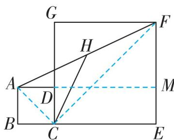

> [!success]- 必刷题
>
> > [!success] **【答案】** B
>
> > [!note]- **【解析】**
> > ## - 添加辅助线
> >
> > 由 $H$ 是中点, 想到可以利用直角三角形斜边上中线的性质, 然后尝试作辅助线构造直角三角形. 首先想到延长 $AD$ 交 $EF$ 于 $M$ 得到直角三角形, 但是 $CH$ 与这个直角三角形没有关系, 所以想到连接两个正方形的对角线构造直角三角形, 则 $CH$ 是所作直角三角形的斜边上的中线.
> >
> > 【解析】如图，∵正方形ABCD和正方形CEFG中，点D在CG上，BC=1, CE=3, ∴AD=AB=BC=1, CE=EF=3,
> >
> > 
> >
> > $\angle E = 90^{\circ}$ . 延长 $AD$ 交 $EF$ 于 $M$ , 连接 $AC, CF$ , 则 $AM = BC + CE = 1 + 3 = 4$ , $FM = EF - AB = 3 - 1 = 2$ , $\angle AMF = 90^{\circ}$ . $\because$ 四边形 $ABCD$ 和四边形
> >
> > GCEF 是正方形, $\therefore \angle ACD = \angle GCF = 45^{\circ}$ , $\therefore \angle ACF = 90^{\circ}$ . $\because H$ 为 $AF$ 的中点, $\therefore CH = \frac{1}{2} AF$ . 在 Rt $\triangle AMF$ 中, 由勾股定理得 $AF = \sqrt{AM^{2} + FM^{2}} = \sqrt{4^{2} + 2^{2}} = 2\sqrt{5}$ , $\therefore CH = \sqrt{5}$ ,
> >
> > 故选 **B**.
