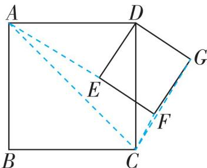

> [!success]- 必刷题
>
> > [!success] **【答案】** C
>
> > [!note]- **【解析】**
> > 如图, 连接 AE, CF, CG. ∵ 四边形 DEFG 是正方形, ∴ $\angle EDG = 90^{\circ}$ , EF = DE =
> >
> > $DG.\because$ 四边形 $ABCD$ 是正方形， $\therefore AD = CD,$ $\angle ADC = 90^{\circ},\therefore \angle ADE =$ $\angle CDG,\therefore \triangle ADE\cong \triangle CDG$ （SAS）， $\therefore AE = CG,$
> >
> > 
> >
> > $\therefore d_{1} + d_{2} + d_{3} = EF + CF + CG = EF + CF + AE, \therefore$ 点 $A, E, F, C$ 在同一条直线上时， $EF + CF + AE$ 最小，即 $d_{1} + d_{2} + d_{3}$ 最小。连接 $AC$ ，则 $d_{1} + d_{2} + d_{3}$ 的最小值为 $AC$ 的长。在 Rt $\triangle ABC$ 中， $AC = \sqrt{2} AB = 2\sqrt{2}, \therefore d_{1} + d_{2} + d_{3}$ 的最小值为 $2\sqrt{2}$ 。
> >
> > 故选 **C**.
