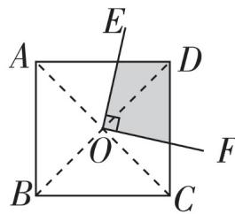
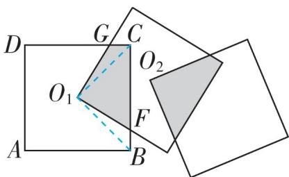

> [!success]- 必刷题
>
> > [!success] **【答案】** 30°
>
> > [!note]- **【解析】**
> > 设 AC 交 BD 于 O. ∵ 四边形 ABCD 是正方形, ∴ AC ⊥ BD, CD = CB, ∠BCD = 90°, OB = OD, ∴ OC = OD = OB = $\frac{1}{2}$ BD, ∠DOF = ∠COE = 90°, ∴ ∠OBC = ∠OCB = 45°. ∵ EF // BC, ∴ ∠OEF = ∠OBC = ∠OCB = ∠OFE = 45°, ∴ OF = OE. ∵ ∠CEF = 15°, ∴ ∠OCE = ∠OFE - ∠CEF = 45° - 15° = 30°. 在 △DOF 和 △COE 中, $\left\{\begin{aligned}OD &= OC, \\ \angle DOF &= \angle COE, \\ OF &= OE,\end{aligned}\right.$ $\triangle DOF \cong \triangle COE (SAS), \therefore \angle ODF = \angle OCE = 30°$ , 即 ∠EDF = 30°. 故答案为 30°.
> >
> > 思路分析
> > 先根据菱形的性质得出 $EF \perp CD$ ，再根据正方形的性质得出 $\angle A = \angle ADC = 90^{\circ}$ ，于是得出四边形 ADGE 是矩形，即可求出 DG, EG 的长，利用勾股定理可求出 CE 的长，然后根据等面积法可求出 GN 的长，再根据矩形的对边相等即可得出 HM 的长.
> >
> > 识图解题 | 过正方形中心的直角形成的面积问题
> > 若∠EOF=90°,则
> > S阴影=S△DOC=1/4S正方形ABCD.
> >
> > 
> >
> > 【解析】连接 $O_{1}B, O_{1}C$ , 如图. $\because \angle BO_{1}F + \angle FO_{1}C = 90^{\circ}, \angle FO_{1}C + \angle CO_{1}G = 90^{\circ}, \therefore \angle BO_{1}F =$
> >
> > $\angle CO_{1}G.$ $\because$ 四边形ABCD是正方形， $\therefore$ 易知 $BO_{1} = CO_{1}$ $\angle O_{1}BF = \angle O_{1}CG = 45^{\circ}$ .在 $\triangle O_1BF$ 和 $\triangle O$
> >
> > 
> >
> > $$
> > \triangle O _ {1} C G
> > $$
> >
> > ## 思路分析
> >
> > 连接 $O_{1}B$ ， $O_{1}C$ ，根据正方形的性质易证 $\triangle O_{1}BF \cong \triangle O_{1}CG(\mathrm{ASA})$ ，可得 $S_{\triangle O_1BF} = S_{\triangle O_1CG}$ ，可将每个阴影部分的面积转化成三角形的面积，根据三角形的面积和正方形的面积的关系即可求解.
> >
> > $\left\{ \begin{array}{l}\angle FO_{1}B = \angle CO_{1}G,\\ BO_{1} = CO_{1},\quad \therefore \triangle O_{1}BF\cong \triangle O_{1}CG\\ \angle FBO_{1} = \angle GCO_{1}, \end{array} \right.$ (ASA), $\therefore S_{\triangle O_1BF} = S_{\triangle O_1CG},\therefore$ 左侧阴影部分的面积是 $\frac{1}{4} S_{\text{正方形}ABCD}$ . 同理可得右侧阴影部分的面积也是 $\frac{1}{4} S_{\text{正方形}ABCD},\therefore$ 阴影部分的面积和为 $2 = \frac{1}{2} S_{\text{正方形}ABCD},\therefore S_{\text{正方形}ABCD} = 4 = AD^2,\therefore AD = 2,$ 故答案为2.
