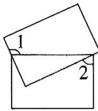

<!-- question-source:start -->
3[2024 湖北武汉调研]两个矩形的位置如图所

示,若 $\angle1=\alpha$ ,则 $\angle2=$ ( )
A. $\alpha-90^{\circ}$ B. $180^{\circ}-\alpha$ C. $\alpha-45^{\circ}$ D. $270^{\circ}-\alpha$

<!-- question-source:end -->

![[Q00107310A1]]
