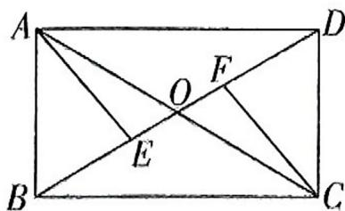

<!-- question-source:start -->
4[2024广西南宁质检]如图,矩形ABCD的对角线AC,BD相交于点O,点E,F在BD上, BE=DF.

(1) 求证: $AE = CF$ ;

(2) 若 $AB = 6, \angle COD = 60^{\circ}$ , 求矩形 $ABCD$ 的面积.

建议用时 25 分钟 答案 D6
<!-- question-source:end -->

![[Q00107311A1]]
