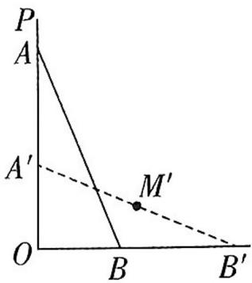
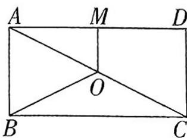

<!-- question-source:start -->
5[2025 陕西宝鸡质检]如图,一架梯子AB斜靠在一竖直的墙OP上,OA=12m,OB=5m.若梯子顶端A沿墙下滑a m到A'的位置,则此时梯子的中点M'到墙角O的距离为( )
A.5.5m B.6m
C.6.5m D.7m

(第5题图)

(第6题图)
<!-- question-source:end -->

![[Q00107312A1]]
