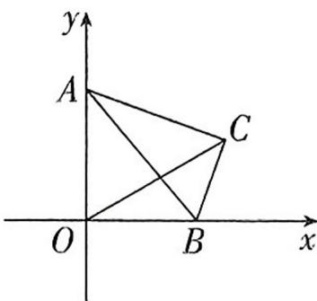
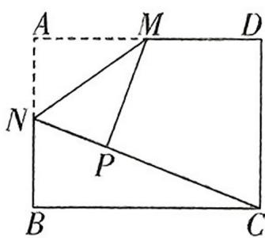

<!-- question-source:start -->
5[2024 山东青岛调研, 中] 如图, 在平面直角坐标系中, 点 $O$ 为坐标原点, 将含 $30^{\circ}$ 角的 Rt $\triangle ABC$ 放在第一象限, 其中 $30^{\circ}$ 角的对边 $BC$ 长为 1 , 斜边 $AB$ 的端点 $A, B$ 分别在 $y$ 轴的正半轴、 $x$ 轴的正半轴上滑动, 连接 $OC$ , 则线段 $OC$ 的长的最大值是 ( )
A. $\sqrt{5}$ B. $\sqrt{3}$ C. 2    D. $\sqrt{7}$

(第5题图)

(第6题图)
<!-- question-source:end -->

![[Q00107317A1]]
