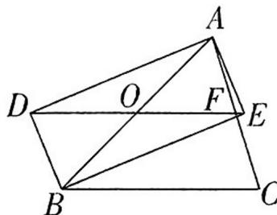

<!-- question-source:start -->
6[2025 四川达州期末, 中]如图, 在矩形 $ABCD$ 中, $AB = 3$ , $BC = 4$ , 点 $M$ 为 $AD$ 的中点, 点 $N$ 为 $AB$ 上一点, 连接 $MN$ , $CN$ , 将 $\triangle AMN$ 沿直线 $MN$ 折叠后, 点 $A$ 恰好落在 $CN$ 上的点 $P$ 处, 则 $CN$ 的长为 \_\_\_\_.

[2024 广东深圳质检, 中] 如图, 以 $\triangle ABC$ 的边 $AB$ 为对角线构造矩形 $ADBE$ , 连接 $DE$ 分别交 $AB, AC$ 于点

O,F,若F为AC中点,BD=5,AD=BC=12,则EF=\_.
<!-- question-source:end -->

![[Q00107318A1]]
