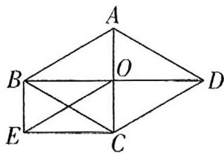

<!-- question-source:start -->
8[2024 北京东城区期末, 中]如图, 四边形 $ABCD$ 的对角线 $AC$ , $BD$ 相交于点 $O$ , $BC$ , $EO$ 为矩形 $BECO$ 对角线, $BC \parallel AD$ , $AD = EO$ .

(1)求证:四边形ABCD是菱形;

(2) 连接 $DE$ , 若 $AC = 4, \angle BCD = 120^{\circ}$ , 求 $DE$ 的长.

<!-- question-source:end -->

![[Q00107319A1]]
