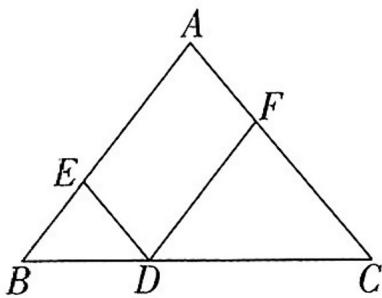
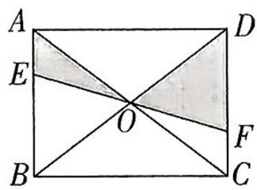

<!-- question-source:start -->
1 如图, 在 $\triangle ABC$ 中, $AB = AC$ , 点 $D$ 在 $BC$ 边上, $DF \parallel AB$ , $DE \parallel AC$ , 则当 $\angle B =$ \_\_\_\_°时, 四边形 $AEDF$ 是矩形.

(第1题图)

(第2题图)
<!-- question-source:end -->

![[Q00107750A1]]
