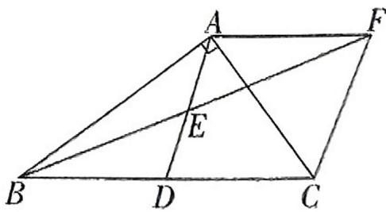

<!-- question-source:start -->
7 [2024 江苏扬州质检] 如图, 在 Rt $\triangle ABC$ 中, $\angle BAC = 90^{\circ}$ , D 是 BC 的中点, E 是 AD 的中点, 过点 A 作 AF//BC 交 BE 的延长线于点 F.

(1) 求证: $\triangle AEF \cong \triangle DEB$ ;

(2)证明四边形 ${ADCF}$ 是菱形.

<!-- question-source:end -->

![[Q00107751A1]]
