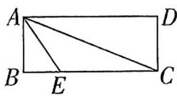
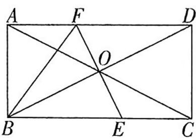

<!-- question-source:start -->
1 [2025 山西临汾曲沃期末, 中] 如图, 在矩形 ABCD 中, AB = 5, CB = 12, 连接 AC, $\angle BAC$ 的平分线交 BC 于点 E, 则线段 BE 的长为 ( )
A. $\frac{10}{3}$ B. $\frac{11}{3}$ C.3 D.4

(第1题图)

(第2题图)
<!-- question-source:end -->

![[Q00107752A1]]
