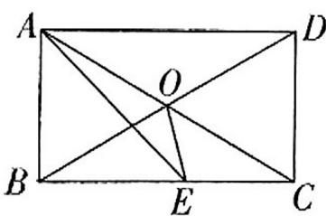
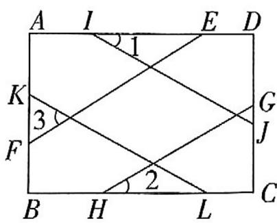

<!-- question-source:start -->
3 [2024 浙江杭州拱墅区调研, 中] 如图, 矩形 ABCD 中, AC 与 BD 相交于点 O, AE 平分 $\angle BAD$ , 若 $\angle EAO = 15^{\circ}$ , 则 $\angle AEO$ 的度数为 ( )
A. $25^{\circ}$ B. $30^{\circ}$ C. $45^{\circ}$ D. $60^{\circ}$

(第3题图)
(第4题图)
<!-- question-source:end -->

![[Q00107754A1]]
