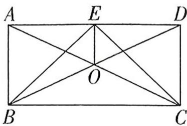
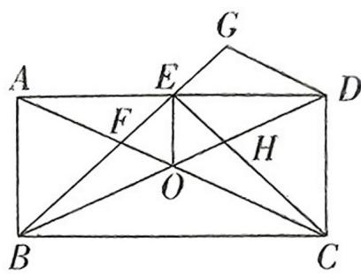

<!-- question-source:start -->
9 核心素养推理能力 [较难] 已知矩形 $ABCD$ 的对

角线 $AC, BD$ 相交于点 $O$ , 点 $E$ 是边 $AD$ 上一点, 连接 $BE, CE, OE$ , 且 $BE = CE$ .

(1)如图(1),求证: $\triangle BEO\cong\triangle CEO;$

图(1)

(2)如图(2), 设 $BE$ 与 $AC$ 相交于点 $F, CE$ 与 $BD$ 相交于点 $H$ , 过点 $D$ 作 $AC$ 的平行线交 $BE$ 的延长线于点 $G$ , 在不添加任何辅助线的情况下, 请直接写出图(2)中的四个三角形 ( $\triangle AEF$ 除外), 使写出的每个三角形的面积都与 $\triangle AEF$ 的面积相等.

图(2)
<!-- question-source:end -->

![[Q00107755A1]]
