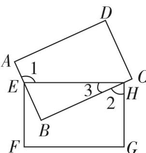

> [!success]- 必刷题
>
> > [!success] **【答案】** B
>
> > [!note]- **【解析】**
> > 如图, ∵ 四边形 $ABCD$ , 四边形 $EFGH$ 都是矩形, ∴ $\angle B = \angle EHG = 90^\circ$ . ∵ $\angle 1$ 是 $\triangle EBH$ 的一个外角, ∴ $\angle 3 = \angle 1 - \angle B =$
> >
> > 
> >
> > $\alpha - 90^{\circ}, \therefore \angle 2 = \angle E H G - \angle 3 = 90^{\circ} - (\alpha - 90^{\circ}) = 180^{\circ} - \alpha$ ，
> >
> > 故选 **B**.
