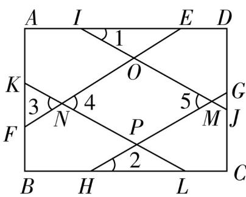

> [!success]- 必刷题
>
> > [!success] **【答案】** D
>
> > [!note]- **【解析】**
> > 如图, ∵ 四边形 ABCD 是矩形,
> >
> > $\therefore \angle C = \angle D = 90^{\circ},$ $\therefore \angle 1 + \angle MJG = 90^{\circ},$ $\angle 2 + \angle MGJ = 90^{\circ}.$ $\because \angle 1 = \angle 2 = 30^{\circ},$ $\therefore \angle MJG = \angle MGJ =$
> >
> > 
> >
> > $60^{\circ}, \therefore \angle GMJ = 180^{\circ} - \angle MJG - \angle MGJ = 60^{\circ},$ $\therefore \angle 5 = 60^{\circ}. \because IJ \parallel KL, EF \parallel GH, \therefore$ 四边形 NPMO 是平行四边形, $\therefore \angle 4 = \angle 5 = 60^{\circ},$ $\therefore \angle 3 = \angle 4 = 60^{\circ}$ .
> >
> > 故选 **D**.
