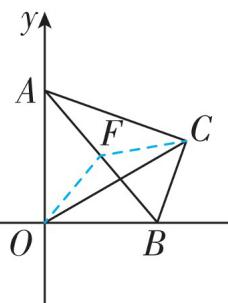

> [!success]- 必刷题
>
> > [!success] **【答案】** C
>
> > [!note]- **【解析】**
> > 如图, 取 AB 的中点 F, 连接 CF,
> >
> > OF. 在 Rt $\triangle ABC$ 中， $\because \angle ACB = 90^{\circ}, \angle BAC = 30^{\circ}, BC = 1, \therefore AB = 2BC = 2.$ $\because \angle AOB = 90^{\circ}, AF = FB, \therefore OF = FC = \frac{1}{2} AB = 1.$
> >
> > 
> >
> > $\because OC \leqslant OF + CF, \therefore$ 当 $O, F, C$ 共线时, $OC$ 的值最大, 最大值为 $OF + CF = 2$ .
> >
> > 故选 **C**.
