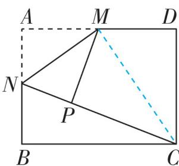

> [!success]- 必刷题
>
> > [!success] **【答案】** 0
>
> > [!note]- **【解析】**
> > 如图, 连接 $CM$ . 在矩形 $ABCD$ 中,
> >
> > $AB = CD = 3, BC = AD = 4,$ $\angle A = \angle B = \angle D = 90^{\circ}.$ 由折叠可知， $\angle A = \angle MPN =$ $90^{\circ},AM = PM.\because$ 点 $M$ 为 $AD$ 的中点， $\therefore AM = DM =$
> >
> > 
> >
> > $PM=\frac{1}{2}AD=2.$ 在 Rt△DMC 和 Rt△PMC 中， $\left\{\begin{aligned}DM&=PM,\\ MC&=MC,\end{aligned}\right.$ $\therefore$ Rt△DMC ≅ Rt△PMC (HL), $\therefore PC=DC=3.$ 设 AN=x，则 PN=x, BN=3-x, $\therefore CN=3+x.$ 在 Rt△BCN 中, $BC^{2}+BN^{2}=CN^{2}$ ,
> > 即 $4^{2}+(3-x)^{2}=(3+x)^{2}$ ，解得 $x=\frac{4}{3},\therefore CN=3+\frac{4}{3}=\frac{13}{3}.$
> >
> > 7.0.5
> >
> > 思路分析
> > 由矩形性质和勾股定理得DE=13,OD=OE=6.5
> > 由三角形中位线定理得OF= $\frac{1}{2}$ BC=6
> > EF=OE-OF=0.5
> >
> > 【解析】在矩形 ADBE 中, BD = 5, AD = 12, ∠ADB = 90°, DE = AB, OA = OB = OD = OE. 在 Rt△ABD 中, $AB = \sqrt{BD^{2} + AD^{2}} = \sqrt{5^{2} + 12^{2}} = 13$ , ∴ DE = 13, ∴ OA = OB = OD = OE = 6.5. ∵ 点 O, F 分别是 AB, AC 的中点, ∴ OF 为 △ABC 的中位线, ∴ $OF = \frac{1}{2}BC = \frac{1}{2} \times 12 = 6$ , ∴ EF = OE - OF = 6.5 - 6 = 0.5. 故答案为 0.5.
