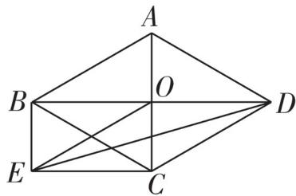

> [!success]- 必刷题
>
> > [!success] **【答案】** (1)
>
> > [!note]- **【解析】**
> > 【证明】∵四边形 BECO 是矩形, ∴ BC = EO, ∠BOC = 90°, ∴ AC ⊥ BD. ∵ AD = EO, ∴ AD = BC. ∵ BC // AD, ∴ 四边形 ABCD 是平行四边形. 又∵ AC ⊥ BD, ∴ 四边形 ABCD 是菱形.
> > (2)【解】如图, ∵ 四边形 ABCD 是菱形, ∠BCD = 120°, ∴ ∠ABC = 180° - 120° = 60°,
> >
> > $AB = BC, AO = CO = 2,$ $BO = DO, \angle ABO = \angle CBO,$ $\therefore \triangle ABC$ 是等边三角形， $\therefore AB = AC = 4,$
> >
> > 
> >
> > $\therefore BO = \sqrt{AB^2 - AO^2} = 2\sqrt{3}, \therefore BD = 4\sqrt{3}.$ 四边形 $BECO$ 是矩形， $\therefore BE = CO = 2, \angle DBE = 90^\circ,$ $\therefore DE = \sqrt{BD^2 + BE^2} = \sqrt{(4\sqrt{3})^2 + 2^2} = 2\sqrt{13}.$
> >
> > ## 刷素养·
> >
> > 思路分析
> > 证得四边形ABCD是菱形, 得 $CD = AD = 5$ , 连接 $PD$ , 由三角形面积关系求出 $PM + PN = 4.8$ , 则当 $PB$ 最短时, $PM + PN + PB$ 有最小值, 即当 $BP \perp AC$ 时, $PB$ 最短, 即可得出答案.
