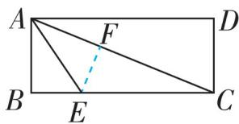

> [!success]- 必刷题
>
> > [!success] **【答案】** A
>
> > [!note]- **【解析】**
> > 如图,作 $EF \perp AC$ 于点 F, 则 $\angle AFE = \angle CFE = 90^{\circ}$ . ∵ 四边形 ABCD 是矩
> >
> > 
> >
> > 形, $AB = 5$ , $CB = 12$ , $\therefore \angle B = 90^{\circ}$ , $\therefore EB \perp AB$ , $AC = \sqrt{AB^{2} + CB^{2}} = 13$ . $\because AE$ 平分 $\angle BAC$ , $\therefore FE = BE$ . 在 Rt $\triangle AFE$ 和 Rt $\triangle ABE$ 中, $\left\{ \begin{array}{l} AE = AE, \\ FE = BE, \end{array} \right.$ $\therefore \mathrm{Rt} \triangle AFE \cong \mathrm{Rt} \triangle ABE (\mathrm{HL}),$ $\therefore AF = AB = 5$ . $\because FE^{2} + CF^{2} = CE^{2}$ , 且 $CF = 13 - 5 = 8$ , $CE = 12 - BE$ , $\therefore BE^{2} + 8^{2} = (12 - BE)^{2}$ , $\therefore BE = \frac{10}{3}$ ,
> >
> > 故选 **A**.
