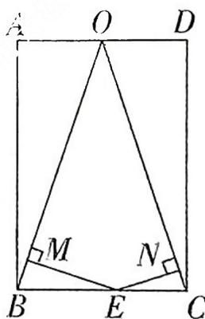
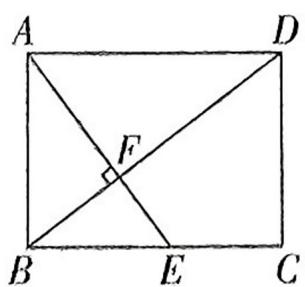
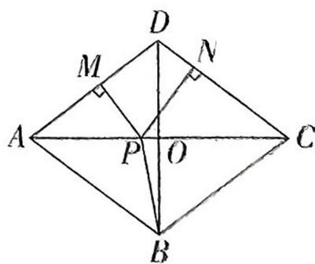
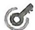

## 课时 1 矩形的性质 刷提升

![[初中/课堂同步/教辅/必刷题/2026《初中必刷题》数学北师9上/01_第一章_特殊平行四边形/课时_1_矩形的性质/questions/Q00107752.md]]
![[初中/课堂同步/教辅/必刷题/2026《初中必刷题》数学北师9上/01_第一章_特殊平行四边形/课时_1_矩形的性质/questions/Q00107753.md]]
![[初中/课堂同步/教辅/必刷题/2026《初中必刷题》数学北师9上/01_第一章_特殊平行四边形/课时_1_矩形的性质/questions/Q00107754.md]]
![[初中/课堂同步/教辅/必刷题/2026《初中必刷题》数学北师9上/01_第一章_特殊平行四边形/课时_1_矩形的性质/questions/Q00107316.md]]
![[初中/课堂同步/教辅/必刷题/2026《初中必刷题》数学北师9上/01_第一章_特殊平行四边形/课时_1_矩形的性质/questions/Q00107317.md]]
![[初中/课堂同步/教辅/必刷题/2026《初中必刷题》数学北师9上/01_第一章_特殊平行四边形/课时_1_矩形的性质/questions/Q00107318.md]]
![[初中/课堂同步/教辅/必刷题/2026《初中必刷题》数学北师9上/01_第一章_特殊平行四边形/课时_1_矩形的性质/questions/Q00107319.md]]

## 刷素养

走向重高

![[初中/课堂同步/教辅/必刷题/2026《初中必刷题》数学北师9上/01_第一章_特殊平行四边形/课时_1_矩形的性质/questions/Q00107755.md]]

## 微专题1 特殊平行四边形中等积法的应用

方法指导 如图, 在矩形 $ABCD$ 中, $AB=3, BC=2, O$ 是 $AD$ 的中点, 连接 $OB, OC$ , 点 $E$ 在线段 $BC$ 上 (点 $E$ 不与点 $B, C$ 重合), 过点 $E$ 作 $EM \perp OB$ 于 $M, EN \perp OC$ 于 $N$ , 求 $EM+EN$ 的值.

解: 连接 OE. ∵ 四边形 ABCD 是矩形, ∴ CD = AB = 3, AD = BC = 2, ∠A = ∠D = 90°.

∵ O 是 AD 的中点, ∴ AO = DO = 1, ∴ OB = OC = $\sqrt{3^{2} + 1^{2}} = \sqrt{10}$ .

∵△OBE的面积+△OCE的面积=\_\_\_\_，

$$
\therefore \frac {1}{2} O B \cdot E M + \frac {1}{2} O C \cdot E N = \frac {1}{2} B C \cdot A B
$$

$\therefore \frac{1}{2} (EM + EN) \times \sqrt{10} = \frac{1}{2} \times 2 \times 3$ ，解得 $EM + EN =$ \_\_\_\_.

## 针对训练

[2025 广西玉林期末, 中] 如图, 在矩形 ABCD 中, AB = 3, BC = 4, AE ⊥ BD 于 F, 则线段 AF 的长是 ( )

A. 3 B. 2.5 C. 2.4 D. 2 [2024 陕西咸阳秦都区调研,较难]如图所示,四边形ABCD中, $AC\perp BD$ 于点O,AO=CO=4,

$BO = DO = 3$ , 点 $P$ 为线段 $AC$ 上的一个动点. 过点 $P$ 分别作 $PM \perp AD$ 于点 $M$ , $PN \perp DC$ 于点 $N$ . 连接 $PB$ , 在点 $P$ 运动过程中,

$PM+PN+PB$ 的最小值等于 \_\_\_\_.

