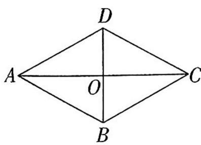
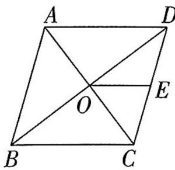

<!-- question-source:start -->
2 如图, 在菱形 $ABCD$ 中, 对角线 $AC, BD$ 相交于点 $O$ , 下列结论中错误的是 ( )
A. $AB = AD$ B. $AC \perp BD$ C. $AC = BD$ D. $\angle DAC = \angle BAC$

(第2题图)

(第3题图)
<!-- question-source:end -->

![[Q00107283A1]]
