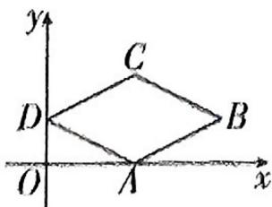
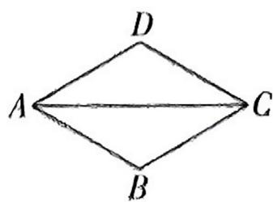

<!-- question-source:start -->
4[2024 甘肃兰州城关区期中]如图,在菱形ABCD中,点A在x轴上,点B的坐标为(8,2),点D的坐标为(0,2),则点C的坐标为( )
A.(2,2) B.(2,4)
C.(4,2) D.(4,4)

(第4题图)

(第5题图)

建议用时 25 分钟 答案 D1
<!-- question-source:end -->

![[Q00107285A1]]
