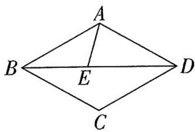

<!-- question-source:start -->
6[2025 陕西榆林调研]如图, 点 E 是菱形 ABCD 的对角线 BD 上一点, 连接 AE, 若 AD = DE, $\angle AEB = 105^{\circ}$ , 则 $\angle BAE$ 的度数为 \_\_\_\_°.

制发财了鸭
<!-- question-source:end -->

![[Q00107287A1]]
