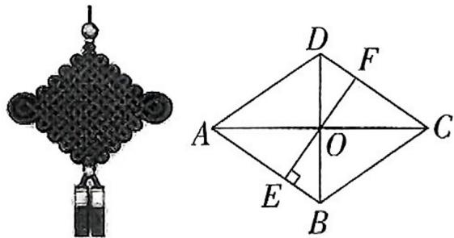

<!-- question-source:start -->
7[2024 河南周口调研]如图,小陶家有一个菱形中国结装饰,测得 $BD = 12 \mathrm{~cm}, AC = 16 \mathrm{~cm}, AC$ , $BD$ 交于点 $O, EF \perp AB$ 分别交 $AB, CD$ 于点 $E$ , $F$ , 则 $EF$ 的长为 \_\_\_\_ cm.

<!-- question-source:end -->

![[Q00107288A1]]
