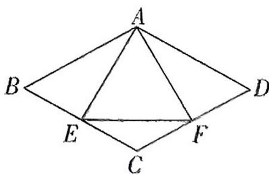

<!-- question-source:start -->
8[2025 湖南张家界质检]如图,在菱形 ABCD 中, $AE \perp BC$ 于点 E, $AF \perp CD$ 于点 F,连接 EF.
(1) 求证: AE = AF;

(2) 若 $\angle B = 60^{\circ}$ , 求 $\angle AEF$ 的度数.

<!-- question-source:end -->

![[Q00107289A1]]
