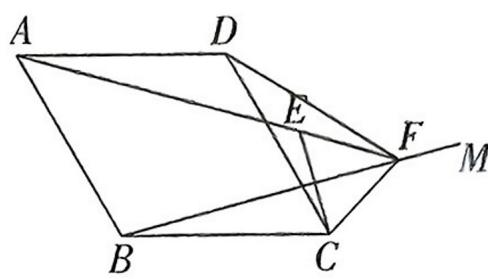

<!-- question-source:start -->
5 [2025 辽宁铁岭质检, 中] 如图, 在菱形 $ABCD$ 中, $\angle ABC = 120^{\circ}$ , 射线 $BM$ 以点 $B$ 为旋转中心, 从 $BC$ 的位置开始逆时针旋转, 旋转角为 $\alpha (0^{\circ} < \alpha < 120^{\circ})$ , 点 $E$ 与点 $C$ 关于 $BM$ 成轴对称, 连接 $AE$ 并延长与 $BM$ 交于点 $F$ , 连接 $CE, CF, DF$ .

(1)试判断 $\triangle CEF$ 的形状,并说明理由;

(2) 当点 $E$ 为 $AF$ 中点时, 求此时旋转角 $\alpha$ 的度数.

<!-- question-source:end -->

![[Q00107292A1]]
