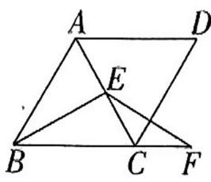
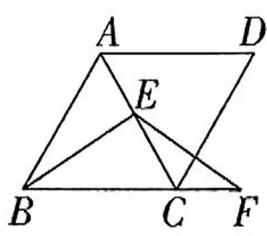
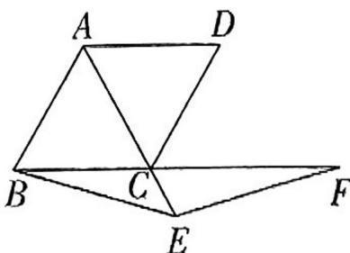

<!-- question-source:start -->
6 核心素养推理能力 [难] 在菱形 ABCD 中, $\angle ABC = 60^{\circ}$ , E 是对角线 AC 上任意一点, F 是线段 BC 延长线上一点, 且 CF = AE, 连接 BE, EF.

(1)如图(1),当E是线段AC的中点时,BE和EF的数量关系是\_\_\_\_.

(2)如图(2), 当点 $E$ 不是线段 $AC$ 的中点, 其他条件不变时, 请你判断(1)中的结论是否成立. 若成立, 请给予证明; 若不成立, 请说明理由.

(3)如图(3), 当点 E 是线段 AC 延长线上的任意一点, 其他条件不变时, (1) 中的结论是否成立? 若成立, 请给予证明; 若不成立, 请说明理由.

图(1)

图(2)

图(3)
<!-- question-source:end -->

![[Q00107293A1]]
