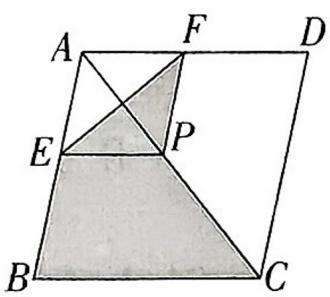
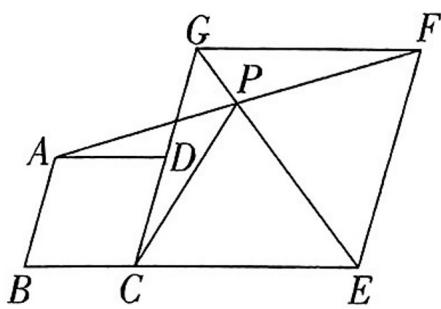

<!-- question-source:start -->
1 [2025 山西运城期中, 中]如图, 菱形 ABCD 的对角线长分别为 8 和 10, P 是较短对角线 AC 上任意一点 (不与点 A, C 重合), PE // BC 交 AB 于点 E, PF // CD 交 AD 于点 F, 连接 EF, 则阴影部分的面积是 ( )
A. 12 B. 20 C. 40 D. 80

(第1题图)

(第2题图)
<!-- question-source:end -->

![[Q00107740A1]]
