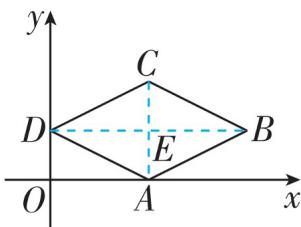

> [!success]- 必刷题
>
> > [!success] **【答案】** D
>
> > [!note]- **【解析】**
> > 连接 AC, BD 交于点 E, 如图所示. ∵ 四边形 ABCD 是菱形, ∴ AC ⊥ BD, AE = CE = $\frac{1}{2}$ AC, BE =
> >
> > 
> >
> > $DE=\frac{1}{2}BD.$ ∵ 点 B 的坐标为 $(8,2)$ ，点 D 的坐标为 $(0,2)$ ，∴ AE=2=OD，DE=OA=4，∴ AC=4，∴ 点 C 的坐标为 $(4,4)$ 。
> >
> > 故选 **D**。
