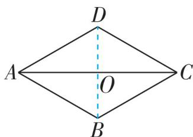

> [!success]- 必刷题
>
> > [!success] **【答案】** D
>
> > [!note]- **【解析】**
> > 如图, 连接 BD 交 AC 于点 O. ∵ 四▶思路分析
> >
> > $$
> > \angle D A B = 6 0 ^ {\circ}, \therefore O A = O C
> > $$
> >
> > 
> >
> > $$
> > \angle B A O = \frac {1}{2} \angle D A B = 3 0 ^ {\circ}
> > $$
> >
> > 刷有所得
> > 在菱形的有关
> > 计算中, 若涉
> > 及与对角线有
> > 关的角度求
> > 值, 则可以用
> > 到菱形的对角
> > 线平分对角;
> > 若涉及与对角
> > 线有关的线段
> > 求值, 则可以
> > 用到菱形对角
> > 线互相垂直平
> > 分; 若涉及边
> > 上的高的求
> > 值, 则可以用
> > 到等积法.
> >
> > $AC \perp BD, \therefore \angle AOB = 90^{\circ}, \therefore OB = \frac{1}{2} AB = \frac{1}{2},$ $\therefore OA = \sqrt{AB^{2} - OB^{2}} = \sqrt{1^{2} - \left(\frac{1}{2}\right)^{2}} = \frac{\sqrt{3}}{2}, \therefore AC = 2OA = \sqrt{3}$ ,
> >
> > 故选 **D**.
