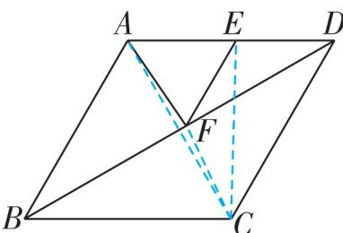

> [!success]- 必刷题
>
> > [!success] **【答案】** $2 + 2\sqrt{3}$
>
> > [!note]- **【解析】**
> > 如图，连接 $CF, CE, AC$ . $\because$ 四边形 $ABCD$ 是菱形， $\therefore AB = BC = CD = AD =$
> >
> > 
> >
> > 4, $\angle ABD = \angle CBD$ , $\angle ABC = \angle ADC = 60^{\circ}$ , $\therefore \triangle ACD$ 是等边三角形. $\because E$ 为 $AD$ 的中点, $\therefore CE \perp AD$ . 在 $\triangle ABF$ 和 $\triangle CBF$ 中, $\left\{ \begin{array}{l} AB = CB, \\ \angle ABF = \angle CBF, \therefore \triangle ABF \cong \triangle CBF (\text { SAS }) , \\ BF = BF, \end{array} \right.$ $\therefore AF = CF, \therefore AF + EF = CF + EF, \therefore$ 当 $C, F, E$ 三点共线, 即 $CF + EF = CE$ 时, $AF + EF$ 的值最小. $\because E$ 为 $AD$ 的中点, $\therefore ED = 2, \therefore$ 在 Rt $\triangle CDE$
> >
> > ## 思路分析
> >
> > 思路分析
> > 连接 CF, CE,
> > AC, 利用 SAS
> > 证明 $\triangle ABF \cong \triangle CBF$ , 得
> > AF = CF, 将 $AF + EF$ 的最小值转化为CE的长即可.
> >
> > 思路分析
> > 根据菱形
> > AECF 得 $\angle FCO = \angle ECO$ ，再利用折叠的性质
> > 可得 $\angle ECO = \angle ECB = \angle FCO = 30^{\circ}$ ，根据直角三角形的性质，结合勾股定理求得 BC，EC 的长，即可求解.
> >
> > 中, $CE=\sqrt{CD^{2}-DE^{2}}=\sqrt{16-4}=2\sqrt{3}$ ,∴ $\triangle AEF$ 周长的最小值为 $AE + AF + EF = AE + CE = 2 + 2\sqrt{3}$ . 故答案为 $2 + 2\sqrt{3}$ .
