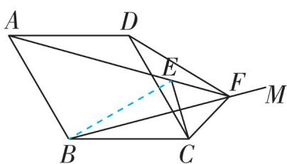
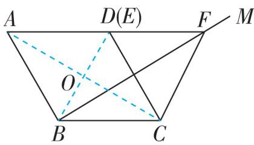

> [!success]- 必刷题
>
> > [!success] **【答案】** 详见解析
>
> > [!note]- **【解析】**
> > 【解】(1) $\triangle CEF$ 是等边三角形, 理由如下: 如图 (1), 连接 $BE$ . $\because$ 四边形 $ABCD$ 是菱形, $\therefore AB=BC$ . $\because E, C$ 关于 $BM$ 对称, $\therefore BC=BE$ , $FE=FC$ , $\therefore AB=BE$ , $\therefore \angle BAE=\angle BEA$ . $\because BC=BE$ , $\therefore \angle BEC=\angle BCE$ . 在四边形 $ABCE$ 中, $\angle ABC=120^{\circ}$ , $\therefore \angle BAE+\angle AEC+\angle BCE=2\angle AEC=360^{\circ}-120^{\circ}=240^{\circ}$ , $\therefore \angle AEC=120^{\circ}$ , $\therefore \angle CEF=60^{\circ}$ . 又 $\because FE=FC$ , $\therefore \triangle CEF$ 是等边三角形.
> >
> > (2) 连接 $AC, BD, AC$ 与 $BD$ 交于点 $O$ , 如图 (2). $\because E$ 为 $AF$ 中点, $\therefore AE = EF$ . 又 $\because \triangle CEF$ 是等边三角形, $\therefore CE = CF = EF, \therefore AE = CE, \angle ECF = \angle EFC, \therefore \angle EAC = \angle ECA, \therefore 2\angle ECA + 2\angle ECF = 180^\circ, \therefore \angle ACF = 90^\circ$ . 在菱形 $ABCD$ 中, $\angle ABC = 120^\circ, AC \perp BD, \therefore \angle AOD = 90^\circ, \angle ADB = \angle BDC = \frac{1}{2}\angle ADC = \frac{1}{2}\angle ABC = 60^\circ, \therefore BD // CF, \therefore \angle BDC = \angle DCF = 60^\circ$ . 又 $\because \angle ECF = 60^\circ, \therefore EC$ 与 $CD$ 重合. $\because$ 四边形 $ABCD$ 是菱形, $\angle ABC = 120^\circ, \therefore \angle BCD = 60^\circ, \therefore \triangle BCD$ 是等边三角形, $\therefore \angle DBC = 60^\circ. \because BM \perp CD, \therefore BM$ 平分 $\angle DBC, \therefore$ 旋转角 $\alpha = 30^\circ$ .
> >
> > 
> > 图(1)
> >
> > 
> > 图(2)
> >
> > ## 刷素养·
