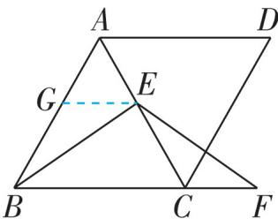
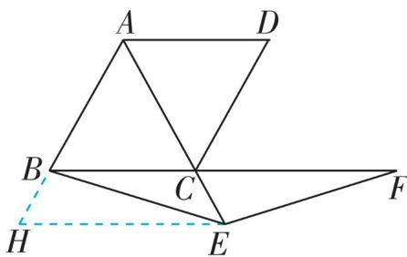

> [!success]- 必刷题
>
> > [!success] **【答案】** BE=EF
>
> > [!note]- **【解析】**
> > 【解】(1)∵四边形ABCD是菱形,∴AB=BC.
> > ∵∠ABC=60°, ∴△ABC是等边三角形,
> > ∴∠BCA=60°. 又∵E是线段AC的中点,
> > ∴∠CBE=∠ABE=30°, AE=CE. ∵CF=AE,
> > ∴CE=CF, ∴∠F=∠CEF= $\frac{1}{2}$ ∠BCA=30°,
> > ∴∠CBE=∠F, ∴BE=EF, 故答案为BE=EF.
> >
> > (2) 结论成立. 证明如下:
> > 过点 E 作 $EG \parallel BC$ 交 AB 于点 G, 如图 (1) 所示.
> > ∵ 四边形 ABCD 为菱形,
> > ∴ AB = BC, AB ∥ CD.
> > ∵ $\angle ABC = 60^{\circ}$ , ∴ $\triangle ABC$
> >
> > 
> > 图(1)
> >
> > 为等边三角形， $\angle BCD = 120^{\circ}$ ， $\therefore \angle ACD =$ $\angle ACB = 60^{\circ}, \angle DCF = \angle ABC = 60^{\circ}, \therefore \angle ECF = 120^{\circ}.\because EG \parallel BC, \therefore \angle AGE = \angle ABC = 60^{\circ}.$ 又 $\because \triangle ABC$ 为等边三角形， $\therefore AB = AC, \angle BAC = 60^{\circ}, \therefore \triangle AGE$ 是等边三角形， $\therefore AG = AE = GE,$ $\therefore BG = CE, \angle BGE = 120^{\circ} = \angle ECF.$ $\because CF = AE, \therefore GE = CF, \therefore \triangle BGE \cong \triangle ECF$ (SAS), $\therefore BE = EF.$
> >
> > (3)结论成立. 证明如下: 过点 E 作 $EH \parallel BC$ 交▶刷有所得
> >
> > AB 的延长线于点 H, 如图(2)所示.
> > ∵ 四边形 ABCD 为菱形, ∴ AB = BC.
> > ∵ $\angle ABC = 60^{\circ}$ ,
> > ∴ $\triangle ABC$ 是等边三菱形中有一个内角是 $60^{\circ}$ ，可以得到以下结论：
> >
> > 
> > 图(2)
> >
> > 角形，∴ AB = AC, $\angle ACB = \angle BAC = 60^{\circ}$ , $\therefore \angle ECF = 60^{\circ}$ . $\because EH \parallel BC$ , $\therefore \angle AHE = \angle ABC = 60^{\circ}$ , $\therefore \triangle AHE$ 是等边三角形, $\therefore AH = AE = HE$ , $\therefore BH=CE,\angle AHE=\angle ECF.\because CF=AE,\therefore HE=CF,\therefore\triangle BHE\cong\triangle ECF(SAS),\therefore BE=EF.$
> >
> > (1) 另一组对角为 $120^{\circ}$ ; (2) 过 $120^{\circ}$ 角的顶点的对角线将菱形分成两个等边三角形;
> >
> > ## 课时 2 菱形的判定
