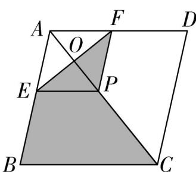

> [!success]- 必刷题
>
> > [!success] **【答案】** B
>
> > [!note]- **【解析】**
> > : 菱形 $ABCD$ 的对角线互相垂直,
> >
> > 且对角线长分别为8和
> > 10, $\therefore S_{菱形ABCD} = \frac{1}{2} \times 8 \times 10 = 40$ . $\because$ 四边形 $ABCD$ 是菱形, $\therefore AB \parallel CD, AD \parallel$
> >
> > 
> >
> > $BC, AB = BC = CD = AD.$ 在 $\triangle ABC$ 和 $\triangle CDA$ 中， $\left\{ \begin{array}{l}AB = CD,\\ BC = DA,\therefore \triangle ABC\cong \triangle CDA(\mathrm{SSS}),\therefore S_{\triangle ABC} = \\ AC = CA, \end{array} \right.$ $S_{\triangle CDA} = \frac{1}{2} S_{菱形ABCD} = \frac{1}{2}\times 40 = 20.$ 如图，设 $EF$ 交 $AP$ 于点 $O.\because PE / / BC,AF / / BC,PF / / CD,AE / /$
> >
> > $CD, \therefore PE \parallel AF, PF \parallel AE, \therefore$ 四边形 $AEPF$ 是平行四边形， $\angle OPF = \angle OAE, \therefore OP = OA.$ 在 $\triangle OPF$ 和 $\triangle OAE$ 中， $\left\{ \begin{array}{l} \angle OPF = \angle OAE, \\ OP = OA, \\ \angle POF = \angle AOE, \end{array} \right.$ $\therefore \triangle OPF \cong \triangle OAE (\text {ASA}), \therefore S_{\triangle OPF} = S_{\triangle OAE}, \therefore S_{\text {阴影}} = S_{\text {四边形 } BEOC} + S_{\triangle OPF} = S_{\text {四边形 } BEOC} + S_{\triangle OAE} = S_{\triangle ABC} = 20.$
> >
> > 故选 **B**.
