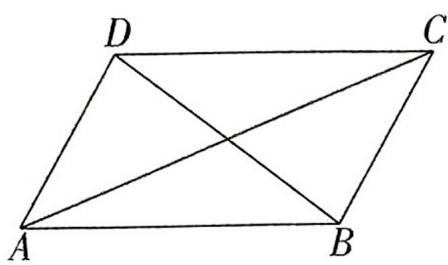
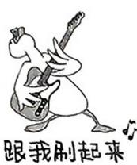

<!-- question-source:start -->
2 如图, 小明在学习了正方形之后, 给同桌小文出了道题, 从下列四个条件: ① AB = BC, ② $\angle ABC = 90^{\circ}$ , ③ AC = BD, ④ AC ⊥ BD 中任选两个作为补充条件, 使 □ABCD 为正方形. 现有下列四种选法, 你认为其中错误的是 ( )

A. ②③
B. ①③
C. ①②
D. ③④
<!-- question-source:end -->

![[Q00107347A1]]
