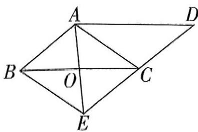

<!-- question-source:start -->
3 如图, 四边形 $ABCD$ 是平行四边形, $AE$ 过 $BC$ 的中点 $O$ 交 $DC$ 的延长线于点 $E$ , 连接 $AC, BE$ . (1) 求证: $\triangle AOB \cong \triangle EOC$ ; (2) 若 $OA = OB$ 且 $\angle D = 45^{\circ}$ , 判断四边形 $ABEC$ 是什么特殊四边形, 并说明理由.

<!-- question-source:end -->

![[Q00107348A1]]
