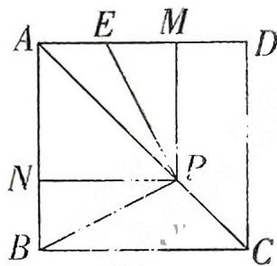

<!-- question-source:start -->
5 如图, 已知正方形 $ABCD, P$ 是对角线 $AC$ 上任意一点, $E$ 为 $AD$ 上的点, 且 $\angle EPB = 90^{\circ}, PM \perp AD, PN \perp AB$ .

(1) 求证: 四边形 PMAN 是正方形;

(2) 求证: EM = BN.

2 刷易错 小心有坑\~
<!-- question-source:end -->

![[Q00107350A1]]
